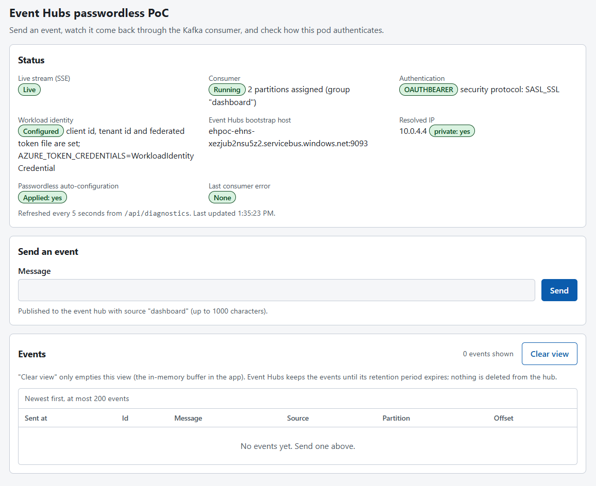

# Passwordless Spring Kafka to Azure Event Hubs on AKS (proof of concept)

A disposable, runnable proof that a Spring Boot service can produce to and consume from Azure Event Hubs over the
Kafka protocol with **no password, connection string or SAS key**, authenticating with an AKS workload identity
(federated token), while the Event Hubs namespace is reachable **only through a private endpoint**.

## What it proves

- One pod on a one-node AKS cluster sends events to an event hub with spring-kafka, and a listener in the Kafka
  consumer group `dashboard` reads them back. A one-page dashboard (`/`) sends events, shows them live over
  Server-Sent Events and clears the in-memory view (the hub itself is never purged).
- Authentication is Spring Cloud Azure's OAUTHBEARER callback handler using a workload identity token. The
  namespace has local (key) authentication disabled, so a secret could not work even by accident.
- `/api/diagnostics` shows, from inside the pod, the effective SASL mechanism, the login handler, whether the
  passwordless auto-configuration really took effect, the private IP the bootstrap host resolves to, and that no
  credential properties are configured.
- Stack: Java 21, Spring Boot 4.1.2, Spring Cloud Azure 7.5.0. Region `australiaeast` by default.

**Result: it works.** Deployed to a real AKS cluster, the service produced to and consumed from Event Hubs with no
secret anywhere, over a private endpoint, and the negative test showed that workload identity is what makes it work.
See [Results](#results-first-live-deployment-2026-11-26).

Layout: `app/` (the service), `infra/` (Bicep), `k8s/` (manifests), `scripts/` (deploy, smoke test, destroy and
their local tests).

## Prerequisites

- PowerShell 7.3+ and the Azure CLI, signed in (`az login`) to the subscription to use. `kubectl` is installed for
  you through the Azure CLI if missing. No local Java, Maven or Docker is needed to deploy.
- Permission to **create role assignments** (Owner or User Access Administrator, or Role Based Access Control
  Administrator, on the subscription or the resource group). The templates assign AcrPull to the cluster and Event Hubs
  Data Sender/Receiver to the workload identity. Contributor alone fails with `AuthorizationFailed`. `deploy.ps1`
  warns (does not block) if it cannot confirm this.
- Quota in the region for a small AKS node pool, and the resource providers registered (the script registers them).
- **`az acr build` available on the subscription.** The image is built remotely by ACR Tasks. Some subscription
  types (free trials, sponsorships) block ACR Tasks; see below.

### If ACR Tasks are blocked

`deploy.ps1` then stops at the build with a message naming the image. Build the image anywhere you have Docker and
push it to the registry under exactly that name, then re-run `deploy.ps1`: it sees the tag already in ACR and skips
the build.

```powershell
az acr login --name <acr-name>                      # needs AcrPush (or Owner/Contributor) on the registry
docker build -t <acr-login-server>/ehpoc:<tag> app  # <tag> is the one printed by the failed run
docker push <acr-login-server>/ehpoc:<tag>
```

The registry is the one deliberate exception to private networking: a **Basic-tier ACR with public endpoints**.
Private endpoints for ACR need the Premium tier, and the PoC is about Event Hubs. Everything else on the data path
(Event Hubs with public access disabled, a private endpoint, the linked private DNS zone) is private; the AKS API
server is public but restricted to your IP.

## Run it

```powershell
pwsh -File scripts/deploy.ps1   # AKS creation takes several minutes on first run
pwsh -File scripts/smoke-test.ps1                # proves the claims; exit code 0 only if every assertion passes
pwsh -File scripts/smoke-test.ps1 -NegativeTest  # opt-in, see warning
pwsh -File scripts/destroy.ps1                   # deletes the whole resource group
```

- `deploy.ps1` detects your public IP (override with `-CallerIp`), deploys the infrastructure, builds the image,
  applies `k8s/`, waits for readiness, then sends one probe event through Event Hubs. It prints the dashboard
  (`http://<ip>/`), `/actuator/health`, `/api/diagnostics` and the send endpoint. Only your IP can reach them. Safe
  to re-run. Role assignments can take up to about five minutes to take effect, so a first-run authorization failure
  is retried (`-VerifyTimeoutSeconds`, default 360) rather than treated as a defect.
- `smoke-test.ps1` checks the HTTP surface (round trip, SSE, diagnostics, clear) and the Azure resources (local
  authentication and public access disabled, role scope, federated subject, no secrets in the namespace).
- **`-NegativeTest` temporarily breaks the federated credential** of the deployed PoC to prove the success is
  caused by workload identity, then restores it (also on failure or Ctrl-C). It asks for confirmation unless
  `-Force`. If a run is killed midway: `pwsh -File scripts/smoke-test.ps1 -RestoreFederatedCredential`.
- `destroy.ps1` asks you to type the resource group name unless `-Force`.

## Local validation (no Azure needed)

```powershell
cd app; ./mvnw package                                 # unit tests plus a round trip against an in-process broker
pwsh -File scripts/tests/smoke-test.tests.ps1          # smoke test against a fake app and fake az/kubectl (~3 min)
pwsh -File scripts/tests/deploy.helpers.tests.ps1      # parse checks and deploy.ps1 helper functions
```

These prove the consumer, buffer, SSE, clear, diagnostics and script logic. They cannot prove anything about Azure.

## Fallback: Spring Boot 3.5.x with Spring Cloud Azure 6.6.0

**Not needed:** Azure's callback handler works with the Kafka 4.2.2 client that Boot 4.1.2 brings (see Results). These
steps are kept for anyone who hits an incompatibility on other versions. They were written from the dependency
differences and have **not been exercised**. To move to the older line, in `app/pom.xml`:

1. Parent `spring-boot-starter-parent` to a 3.5.x release; `spring-cloud-azure.version` to `6.6.0`.
2. Replace `spring-boot-starter-webmvc` with `spring-boot-starter-web`, and `spring-boot-starter-kafka` with plain
   `org.springframework.kafka:spring-kafka` (Boot 3 has no Kafka starter). Keep `spring-boot-starter-actuator`,
   `spring-cloud-azure-starter` (the base starter; check it resolves from the 6.6.0 BOM) and the test dependencies.
3. Jackson 2 instead of Jackson 3: `tools.jackson.databind.json.JsonMapper` / `tools.jackson.databind.JsonNode`
   become `com.fasterxml.jackson.databind.json.JsonMapper` / `com.fasterxml.jackson.databind.JsonNode`
   (`EventConsumer`, `EventPublisher`, `EventStream`, and the test). Jackson 2's `writeValueAsString` and
   `readValue` throw checked `JsonProcessingException`, so wrap them; in tests `JsonNode.asString()` is `asText()`.
4. Any code or test touching `KafkaProperties` imports it from `org.springframework.boot.autoconfigure.kafka`
   (Boot 4 moved it to `org.springframework.boot.kafka.autoconfigure`). Other Boot 4 package moves show up as compile
   errors; fix them the same way.
5. Verify: `cd app; ./mvnw package` (the round-trip test must pass), then redeploy and run the smoke test. The
   configuration in `application.yml` and the Kubernetes and Bicep files do not change.

## Results: first live deployment (2026-11-26)

**Verdict: it worked.** Spring Kafka authenticated to Azure Event Hubs with no password, connection string or SAS key,
using an AKS workload identity, for both the producer and the consumer, over a private endpoint.



Deployed to `australiaeast` (Visual Studio Professional subscription): AKS 1.36 on one `Standard_D2s_v5` node,
Standard-tier Event Hubs (1 TU), Basic ACR. Versions used: Java 21, Spring Boot 4.1.2, Spring Cloud Azure 7.5.0,
spring-kafka 4.1.2, kafka-clients 4.2.2, azure-identity 1.19.0. **The Boot 3.5.x fallback was not needed.**

### The three success criteria

1. **Round trip through Event Hubs.** An event sent with `POST /api/events` was acknowledged by Event Hubs (partition
   and offset returned), then came back through the consumer in `GET /api/events` and over the SSE stream.
2. **No secret anywhere.** The namespace has `disableLocalAuth=true`, so key/SAS access is impossible. The identity
   holds only Event Hubs Data Sender and Data Receiver, scoped to the single event hub. The `poc` namespace has no
   Kubernetes secrets, and the app config has no credential properties.
3. **Private networking and the right auth, visible from inside the pod.** `/api/diagnostics` reports
   `OAUTHBEARER` over `SASL_SSL` with Spring Cloud Azure's `KafkaOAuth2AuthenticateCallbackHandler`, the passwordless
   auto-configuration applied, and the Event Hubs host resolving to a private `10.0.4.x` address.

### Test evidence

- `scripts/smoke-test.ps1` against the live deployment: **19 of 19 assertions passed** (HTTP round trip, SSE,
  diagnostics, clear, and the Azure resource checks).
- `scripts/smoke-test.ps1 -NegativeTest`: **16 of 16 passed.** With the federated credential's subject changed so it
  cannot match, a send returned HTTP 503 `reason=authentication` and the consumer had no partitions (last error
  `KafkaException <- LoginException`). After restoring the credential, the round trip recovered within 8 seconds.
  This shows workload identity is what makes it work. Entra honoured the change about 43 seconds after it was made,
  and only after the pod restarted (a token already issued stays valid until it expires, so restarting the pod is
  what forces a new token exchange).
- Local checks: `./mvnw package` (63 tests), the smoke-test harness (59 scenarios) and the `deploy.ps1` helper tests.

### How the earlier unknowns turned out

| Risk | Outcome |
| --- | --- |
| Azure's OAUTHBEARER handler with the Kafka 4.2.x client | Works with kafka-clients 4.2.2. |
| Offset commits needing more than Data Receiver | They don't. A probe event sent while the restarted consumer still had no partitions was acknowledged, then delivered once it joined. With `auto-offset-reset=latest` that only happens if the group resumed from a committed offset. |
| Token refresh over a long-running connection | **Not observed.** Each pod instance ran for well under an hour (the pod was restarted several times during testing), which is shorter than a typical Entra access token lifetime, so no token expired mid-connection. Locally, with a fake short-lived credential, Kafka's refresh thread did re-invoke Azure's handler. Leave the PoC running for a couple of hours and re-run `smoke-test.ps1` if you want to see a real refresh. |
| Role-assignment propagation (up to ~5 min) | **Not measured.** The first send succeeded on the first attempt, but the role assignment had been created many minutes earlier (AKS creation and the image build ran in between). |
| Private DNS to the private IP from inside the pod | Works: the namespace name resolves to the private endpoint address. |
| Pod hardening (read-only root FS, non-root, no mounted API token, 1Gi limit) | Works. The pod has run with 0 restarts, uses about 245Mi of the 1Gi limit, and the workload identity webhook still projects its own token volume. |
| `az acr build` allowed on the subscription | Yes, on this subscription. |
| Boot 4 Kafka starter name | `spring-boot-starter-kafka`, plus `spring-cloud-azure-starter` (there is no Kafka-specific Azure starter). |

### Bugs the live run found (both fixed)

Both had passed every local test, because the fakes did not model them:

- `deploy.ps1` called `az acr build` with `--file Dockerfile` and an absolute source path. The Azure CLI resolves
  `--file` against the current directory, so it failed with "Unable to find 'Dockerfile'". It now runs from the `app`
  directory with `.` as the source.
- `smoke-test.ps1` never saw the app as ready. PowerShell returns the body as bytes for Spring Boot's
  `application/vnd.spring-boot.actuator.v3+json` type, so the JSON was never parsed. It now decodes the bytes, and the
  test fake serves that content type.

### Caveats

- This is a PoC: no TLS or login on the dashboard (access control is the source-IP allow-list), one replica, no
  autoscaling.
- The container registry is public (Basic tier), and the AKS API server is public but restricted to your IP. Only the
  Event Hubs path is fully private.
- "Clear view" empties the dashboard's in-memory buffer only. Event Hubs keeps events until retention (1 day) expires.
- Not tested: `destroy.ps1`, a change of your public IP between runs, and any test that the load balancer rejects
  other source IPs (that would need a second network).
- The environment is left running after the tests. It costs a little each day, so run `scripts/destroy.ps1` when you
  are done.
